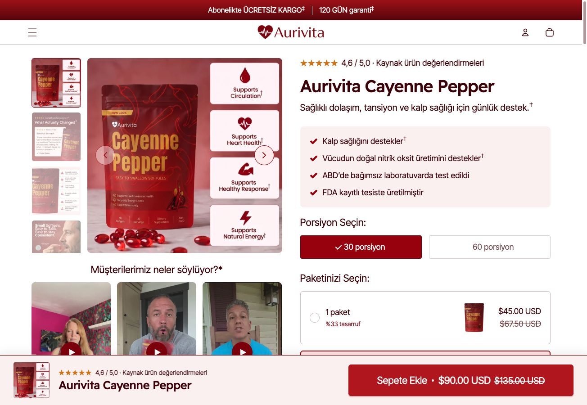
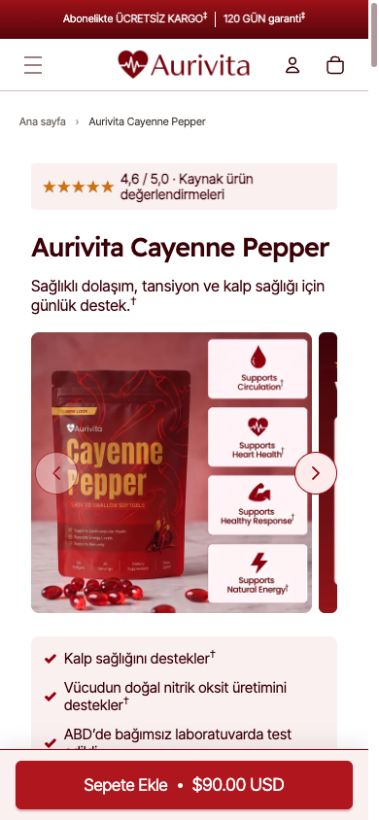

# 🌿 Aurivita · High-Converting WooCommerce Single Product Theme

[](https://github.com/harunsekmen/aurivita-single-product-theme)
[](https://github.com/harunsekmen/aurivita-single-product-theme/blob/main/LICENSE)
[](https://github.com/harunsekmen/aurivita-single-product-theme)

> A specialized WooCommerce theme built around a rich, direct-to-consumer (D2C) Single Product Experience (PDP). Designed for supplement, wellness, and beauty brands that need deep product storytelling, multi-tier bundle selectors, and sticky purchase triggers without heavy page builders.

Developed and maintained by **[Harun Sekmen](https://github.com/harunsekmen)** — E-Commerce Systems Engineer & WooCommerce Developer.

[✉️ Discuss Your Store](mailto:sekmenwp@gmail.com) · [🌐 Website](https://harunsekmen.com) · [🔗 LinkedIn](https://www.linkedin.com/in/harunsekmen/) · [💼 Upwork Profile](https://www.upwork.com/freelancers/~01a7a8b58043e6e6d9)

---

## 📸 Single Product Page Showcase (Desktop & Mobile)

### Desktop Storefront Experience
A complete high-conversion product layout featuring a vertical thumbnail gallery, portion selectors, multi-pack bundle savings cards, customer video proof, and a persistent floating buy bar:



### Mobile-First Shopping Journey
Optimized for mobile shoppers with compact benefit badges, swipeable imagery, and an always-accessible purchase button:



---

## ⚡ The Problem It Solves

Standard WooCommerce themes treat every product like a generic commodity: a plain square image on the left, a short paragraph on the right, and a standard dropdown menu.

For premium direct-to-consumer brands (such as supplements, cosmetics, nutrition, or hero-product brands), that standard layout struggles to convert:
- **No Storytelling Framework:** Shoppers need to see clinical proof, active ingredients, third-party lab testing, and benefits before deciding to buy.
- **Missing Bundle Incentives:** Standard themes offer no built-in way to sell multi-tier packages (e.g. 1-pack, 2-pack, 3-pack with savings percentages) without purchasing expensive third-party plugins.
- **Buy Buttons Disappear on Mobile:** As shoppers scroll down to read reviews or usage routines, the call-to-action disappears off-screen, creating unnecessary purchase friction.
- **Page Builder Drag:** Attempting to build a rich product page using visual page builders often results in deep DOM nesting, sluggish mobile loading times, and broken layouts across updates.

**Aurivita** solves this natively. It provides an editorial-grade, mobile-responsive product detail page (PDP) built directly on core WordPress and WooCommerce hooks, giving brand founders a fast, conversion-optimized shopping journey with zero recurring plugin fees.

---

## 🛠️ Key Single Product Page Features

- **Multi-Angle Gallery & Thumbnail Navigation:** Smooth vertical thumbnail rail on desktop and responsive swipe gallery on mobile.
- **Portion & Serving Selectors:** Clean variant pills (e.g. 30 servings vs 60 servings) that update pricing, dosage, and stock availability dynamically.
- **Tiered Bundle & Volume Pricing Cards:** Pre-configured 1-pack, 2-pack, and 3-pack selection cards highlighting percentage savings to maximize Average Order Value (AOV).
- **Embedded Video Proof & Customer Reviews:** Structured social proof modules answering buyer questions and showcasing real customer experiences.
- **Sticky Add-to-Cart Trigger:** A persistent floating bottom bar that displays the product title, star rating, live variant price, and an instant add-to-cart button as users scroll.
- **Scientific Evidence & FAQ Accordions:** Clean expandable sections detailing mechanisms of action, clinical citations, and frequently asked questions.
- **High-Performance Order Storage (HPOS) Ready:** Fully compatible with WooCommerce modern custom order tables and checkout blocks.

---

## 🏗️ Repository Structure

```
aurivita-single-product-theme/
├── aurivita/                 <-- Main WordPress theme
│   ├── assets/               <-- Minified CSS, JavaScript, and typography
│   ├── data/                 <-- Structured product & framework JSON seeds
│   ├── inc/                  <-- Core theme logic (UI, checkout, performance)
│   ├── template-parts/       <-- Modular templates (product, home, cart drawer)
│   ├── functions.php         <-- Theme setup & asset enqueueing
│   ├── style.css             <-- Theme header metadata
│   └── woocommerce.php       <-- Native WooCommerce product routing
├── aurivita-core/            <-- Companion plugin for brand settings & endpoints
├── docs/
│   └── assets/               <-- High-resolution desktop & mobile preview images
├── LICENSE                   <-- GNU General Public License v3.0
└── README.md                 <-- Open-source documentation
```

---

## 💼 Custom Store Builds & Product Pages With Harun

Need a high-converting product detail page or a custom WooCommerce store built for your brand?

- **Custom Single Product Stores:** Tailored product storytelling, bundle selectors, and brand styling for single-product or D2C catalogs.
- **Figma to WooCommerce:** Converting custom Figma designs into clean, responsive WordPress templates without heavy page builders.
- **Shopify to WooCommerce Migration:** Full transfer of products, customer data, and checkout funnels with zero monthly app fees.
- **Checkout & Speed Optimization:** Custom payment gateway integrations (Stripe, PayPal, iyzico, PayTR) and sub-second page performance.

📩 **Get in touch:** Send your store brief or design file to **[sekmenwp@gmail.com](mailto:sekmenwp@gmail.com)** or connect on **[LinkedIn](https://www.linkedin.com/in/harunsekmen/)**.

---

## 🚀 Installation & Quick Start

1. **Copy the theme to your WordPress installation:**
   ```bash
   cp -R aurivita/ wp-content/themes/aurivita
   cp -R aurivita-core/ wp-content/plugins/aurivita-core
   ```

2. **Activate via WP-CLI:**
   ```bash
   wp theme activate aurivita
   wp plugin activate aurivita-core
   ```

3. **Configure products:** In WP Admin, navigate to **Products > All Products** to configure product options, bundle variations, and benefit badges.

---

## 📄 License

This open-source project is licensed under the **[GNU General Public License v3.0](LICENSE)**.
