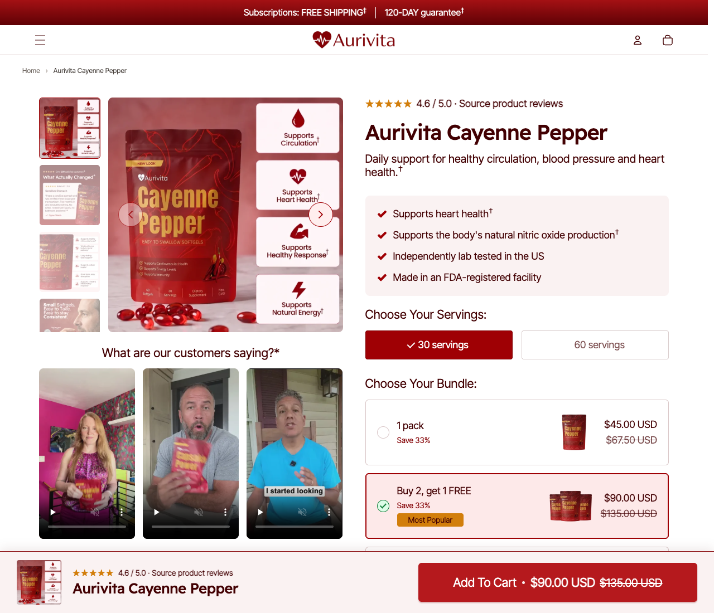
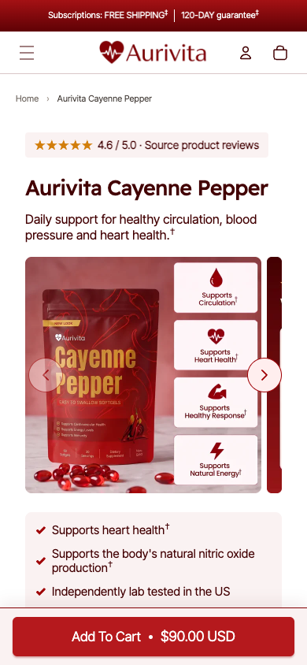
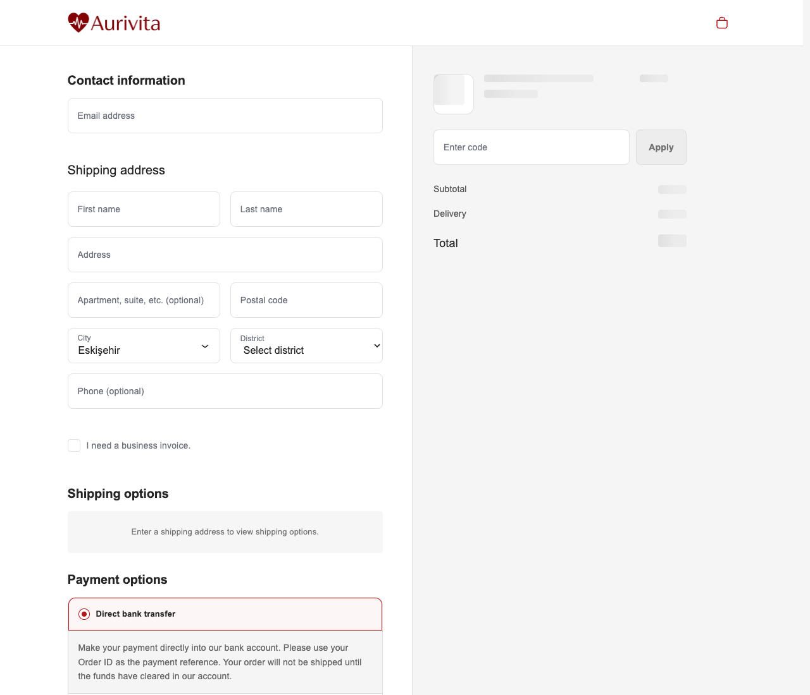
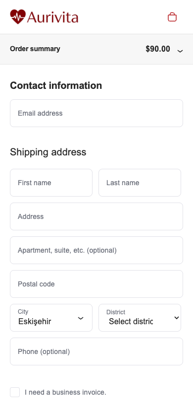

# 🌿 Aurivita · High-Converting WooCommerce Single Product Theme

[](https://github.com/harunsekmen/aurivita-single-product-theme)
[](https://github.com/harunsekmen/aurivita-single-product-theme/blob/main/LICENSE)
[](https://github.com/harunsekmen/aurivita-single-product-theme)

> A specialized, conversion-engineered WooCommerce theme built for direct-to-consumer (D2C) brands in **supplements, wellness, health, and beauty**. Combines deep product storytelling, tiered bundle selectors, and an ultra-clean **Shopify-style single-screen checkout** on self-hosted WooCommerce without heavy page builders.

Developed and maintained by **[Harun Sekmen](https://github.com/harunsekmen)** — E-Commerce Systems Engineer & WooCommerce Developer.

[✉️ Discuss Your Store](mailto:sekmenwp@gmail.com) · [🌐 Website](https://harunsekmen.com) · [🔗 LinkedIn](https://www.linkedin.com/in/harunsekmen/) · [💼 Upwork Profile](https://www.upwork.com/freelancers/~01a7a8b58043e6e6d9)

---

## 📸 1. The High-Converting Single Product Experience (PDP)

Designed specifically for niche consumer brands where customer trust, product mechanisms, and average order value (AOV) are critical to profitability.

### Desktop Product Storytelling
Features a smooth vertical thumbnail gallery, portion selectors, tiered bundle savings cards (*"Buy 2, Get 1 FREE / Save 33%"*), video customer proof carousel, and a persistent floating buy bar:



### Mobile-First Product Layout
Fast, clean mobile navigation with instant benefit badges, swipeable imagery, and an always-accessible purchase button:



---

## 💳 2. Shopify-Style Frictionless Checkout

Standard WooCommerce checkout pages are notoriously clunky—full of redundant fields, confusing accordion steps, and disjointed order reviews that drive cart abandonment.

**Aurivita** replaces legacy checkout templates with a streamlined **Shopify-style single-screen checkout** designed to maximize purchase completion:

### Desktop 2-Column Checkout
A clean, focused layout with 56px input fields, smart city/district selectors, optional business invoice toggle, and a live floating order summary with product thumbnails and bundle savings:



### Mobile Checkout Experience
Includes a compact expandable order summary pill at the top so mobile shoppers always know their exact total without losing their place in the address form:



---

## ⚡ Why This Architecture Converts for Niche Brands

Traditional WooCommerce themes treat every product like a commodity item in a hardware store. For high-ticket supplements, skincare, or single-product brand lines, that approach fails to convert paid traffic:

1. **Deep Product Storytelling:** Educates shoppers directly on the product detail page with clinical citations, lab-testing badges, and active ingredient highlights.
2. **Tiered Bundle Pricing Cards:** Pre-configured 1-pack, 2-pack, and 3-pack cards highlight savings percentages to naturally increase basket sizes.
3. **Video Customer Testimonials:** Real video reviews embedded right below the fold to answer buyer hesitations immediately.
4. **Persistent Sticky Buy Bar:** Keeps the product title, star rating, live variant price, and add-to-cart button in view as users scroll through long-form content.
5. **Shopify-Style Checkout Simplicity:** Eliminates checkout distraction, unnecessary fields, and confusing multi-step redirects.
6. **Zero Builder Bloat:** Native WordPress and WooCommerce templates with High-Performance Order Storage (HPOS) compatibility and zero heavy page builder dependencies.

---

## 🏗️ Repository Structure

```
aurivita-single-product-theme/
├── aurivita/                 <-- Main WordPress theme
│   ├── assets/               <-- Optimized CSS, JavaScript, and typography
│   ├── data/                 <-- Structured product & framework JSON seeds
│   ├── inc/                  <-- Core theme logic (UI, checkout, performance)
│   ├── template-parts/       <-- Modular templates (product, home, cart drawer)
│   │   ├── product/          <-- Single product page templates & sticky bar
│   │   └── checkout/         <-- Shopify-style checkout header, form & footer
│   ├── functions.php         <-- Theme setup & asset enqueueing
│   ├── style.css             <-- Theme metadata
│   └── woocommerce.php       <-- Native WooCommerce product routing
├── aurivita-core/            <-- Companion plugin for brand settings & endpoints
├── docs/
│   └── assets/               <-- High-resolution live desktop & mobile previews
├── LICENSE                   <-- GNU General Public License v3.0
└── README.md                 <-- Open-source documentation
```

---

## 💼 Custom Store Builds & High-Converting PDPs With Harun

Need a high-converting single product page, custom bundle funnel, or Shopify-style checkout on your WooCommerce store?

- **Niche D2C Store Builds:** Bespoke product storytelling, tiered bundle cards, and custom branding for supplements, beauty, and premium consumer products.
- **Shopify-to-WooCommerce Migrations:** Full catalog transfer, checkout funnel replication, and zero monthly app subscriptions.
- **Figma to WooCommerce:** Converting custom Figma designs into responsive, clean WordPress templates.
- **Checkout & Speed Optimization:** Custom payment gateway integrations (Stripe, PayPal, Apple Pay, iyzico, PayTR) with sub-second performance.

📩 **Discuss your project:** Send your store brief or design link to **[sekmenwp@gmail.com](mailto:sekmenwp@gmail.com)** or connect on **[LinkedIn](https://www.linkedin.com/in/harunsekmen/)**.

---

## 🚀 Installation & Quick Start

1. **Copy the theme and companion plugin:**
   ```bash
   cp -R aurivita/ wp-content/themes/aurivita
   cp -R aurivita-core/ wp-content/plugins/aurivita-core
   ```

2. **Activate via WP-CLI:**
   ```bash
   wp theme activate aurivita
   wp plugin activate aurivita-core
   ```

3. **Configure products & checkout:** In WP Admin, navigate to **Products > All Products** to set up bundle variations, serving options, and benefit badges.

---

## 📄 License

This open-source project is licensed under the **[GNU General Public License v3.0](LICENSE)**.
